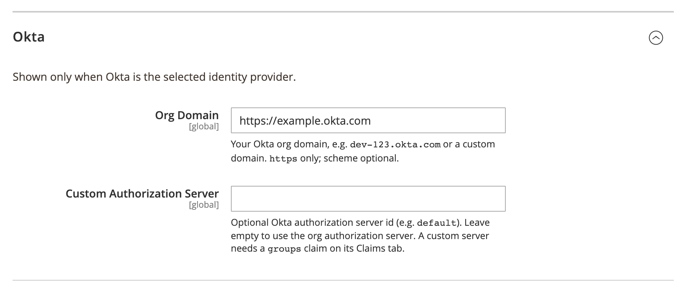

# DmLab_AdminSsoOkta

> Okta login for the Magento 2 admin panel.

[](https://github.com/dmlab-work/module-admin-sso-okta/actions/workflows/ci.yml) [](https://codecov.io/gh/dmlab-work/module-admin-sso-okta) [](https://packagist.org/packages/dmlab/module-admin-sso-okta) [](https://packagist.org/packages/dmlab/module-admin-sso-okta) [](https://packagist.org/packages/dmlab/module-admin-sso-okta) [](LICENSE) 

Your team signs in to the Magento admin with their Okta account — a "Sign in with Okta" button on the admin login page.
Okta groups decide each person's admin role, so there are no separate Magento passwords to manage. Free, no user cap.



## Install

```bash
composer require dmlab/module-admin-sso-okta  # also installs Admin SSO and the SSO engine
bin/magento module:enable DmLab_SsoCore DmLab_AdminSso DmLab_AdminSsoOkta
bin/magento setup:upgrade
```

## Set up the Okta app

In the Okta Admin Console → **Applications → Create App Integration**:

1. Sign-in method **OIDC - OpenID Connect**, application type **Web Application**.
2. **Sign-in redirect URI**: `https://<admin-host>/<admin-path>/adminsso/sso/callback` (`<admin-path>` is the
   backend frontName, default `admin`). It must exactly match the admin URL used at runtime.
3. Save, then copy the **Client ID** and **Client secret**.
4. **Groups claim** (needed for group → role mapping; without it role mapping falls back to the default role):
   - **Org server** (no custom authorization server): app → **Sign On → OpenID Connect ID Token → Groups claim
     filter**, e.g. `Matches regex .*`. The module requests the `groups` scope.
   - **Custom server**: **Security → API → Authorization Servers → `<server>` → Claims** → add `groups`
     (ID Token, Always, value type Groups, filter e.g. `Matches regex .*`). The `groups` scope is not requested.

An existing admin is matched by email only when Okta sends `email_verified=true`.

## Configuration

Admin → Stores → Configuration → **DMLab → Admin SSO**.

| Field | Path | Value |
|---|---|---|
| Enable Admin SSO | `general/enabled` | Yes |
| Identity Provider | `general/active_provider` | Okta |
| Client ID / Client Secret | `general/client_id`, `general/client_secret` | from the Okta app |
| Org Domain | `okta/domain` | e.g. `dev-123.okta.com`; `https` only, scheme optional |
| Custom Authorization Server | `okta/auth_server` | optional server id (e.g. `default`); empty = org server |

Paths are under `dmlab_admin_sso/`. The discovery URL is `https://<domain>/.well-known/openid-configuration`, or
`https://<domain>/oauth2/<auth-server>/.well-known/openid-configuration` with a custom server. Group → role
mapping and enforce-SSO/break-glass are set in [admin-sso](https://github.com/dmlab-work/module-admin-sso).

## Requirements

- Magento 2.4.7+ · PHP 8.2–8.5
- An Okta org on an HTTPS org domain
- Outbound HTTPS from Magento to Okta
- Admin SSO and the SSO engine (`dmlab/module-admin-sso`, `dmlab/module-sso-core`) — installed automatically

Pairs with [admin-scim-okta](https://github.com/dmlab-work/module-admin-scim-okta) for automatic admin offboarding · built on [admin-sso](https://github.com/dmlab-work/module-admin-sso).

## Architecture

This module is the Okta provider plugin for `admin-sso`. It supplies only an Okta preset (`Model/OktaPreset.php`):
the discovery URL built from the org domain, scopes (`groups` only for the org server), the `groups` claim and
the login-button label and logo. `etc/di.xml` registers it into admin-sso's `PresetRegistry`. The OIDC protocol
lives in `sso-core`; admin users, roles and the login flow live in `admin-sso`.

## License

[OSL-3.0](LICENSE) © DMLab. Commercial licensing and support: <https://dmlab.work>.
